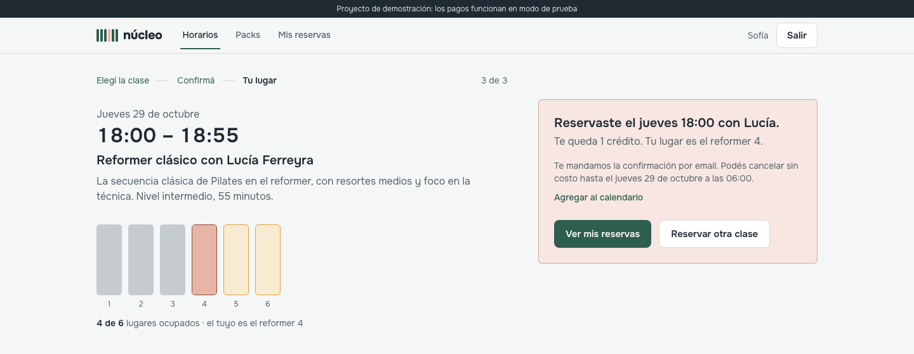
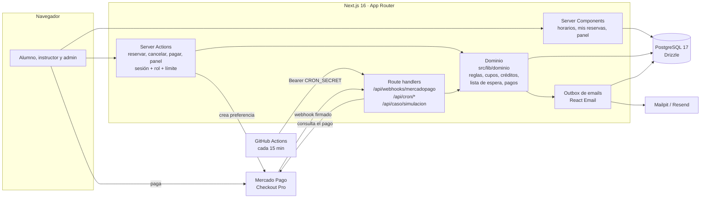

# Núcleo · turnos con pago para un estudio de pilates

> **Proyecto de demostración: los pagos funcionan en modo de prueba.** Núcleo es un estudio
> ficticio de pilates reformer en Buenos Aires, con 6 lugares por clase.

Proyecto de portafolio **«De prototipo a producción»**. Parte de un prototipo de un solo HTML, el
que suele entregar un cliente que ya probó su idea ([`/antes`](public/antes/index.html), con sus 7
problemas marcados como `// PROBLEMA:`), y lo lleva a una app lista para cobrar: reservas que no se
pisan, pagos con Mercado Pago, lista de espera automática, recordatorios y un panel para el
estudio.



<details>
<summary><strong>English summary</strong></summary>

Núcleo is a portfolio demo: a booking and payments app for a fictional pilates reformer studio in
Buenos Aires (6 spots per class). It takes a single-file HTML prototype with 7 real-world problems
(`/antes`) and rebuilds it for production:

- Weekly schedule with live availability, a 3-step booking flow, and packs of 4/8/12 classes valid
  for 30 days, paid with Mercado Pago Checkout Pro (test mode). A booking awaiting payment holds
  the spot for 10 minutes.
- "My bookings" with a 12-hour free-cancellation rule, automatic waitlist promotion, 24-hour email
  reminders (plus a WhatsApp preview), and student / instructor / admin roles with demo logins.
- Admin panel: agenda (drag a class to reschedule it; booked students get an email), recurring
  class templates, instructors, students, payments with CSV export, metrics, email previews and
  dark mode. Students can add a booked class to their calendar (.ics).
- `/caso`, a case study page with a before/after slider and a **live simulation**: 20 people book
  the same 6-spot class at the same time. The prototype code sells 20 spots; the production code,
  running against real PostgreSQL, sells 6 and puts 14 on the waitlist.

Stack: Next.js 16 (App Router), strict TypeScript, Tailwind CSS 4, PostgreSQL 17 + Drizzle
migrations, Better Auth, Radix primitives, React Email + Mailpit. Quality: 59 Vitest tests
(including a concurrency test against real Postgres and signed webhook tests), 7 Playwright
end-to-end flows, Lighthouse mobile ≥ 97 performance and 100 in the other categories, CI on GitHub
Actions.

Run it locally with `pnpm install && pnpm demo` (needs Node 24, pnpm 10 and Docker) or, without
Node, `docker compose --profile completo up --build`. Without Mercado Pago credentials the app uses
a simulated checkout, which can never be enabled in production.

</details>

## Qué hay para ver

| Ruta                                    | Qué es                                                                                                                                                |
| --------------------------------------- | ----------------------------------------------------------------------------------------------------------------------------------------------------- |
| [`/`](http://localhost:3030)            | Horarios de la semana con disponibilidad en tiempo real y lista de espera cuando la clase está completa.                                              |
| `/clase/[id]`                           | Reserva en 3 pasos: elegís la clase, confirmás con crédito o pagando, y ves tu lugar.                                                                 |
| `/packs`                                | Packs de 4, 8 y 12 clases, válidos por 30 días.                                                                                                       |
| `/mis-reservas`                         | Próximas clases (con «Agregar al calendario»), cancelación con la regla de 12 horas, lista de espera, créditos y pagos.                               |
| `/instructor`                           | Las clases de quien enseña, con la lista de cada una y la asistencia.                                                                                 |
| `/admin`                                | Panel del estudio: agenda (se reprograma arrastrando), plantillas, instructores, alumnos, pagos (con CSV), métricas, precios y mensajes. Modo oscuro. |
| [`/antes`](http://localhost:3030/antes) | El prototipo original, sin tocar salvo los comentarios `// PROBLEMA:`.                                                                                |
| [`/caso`](http://localhost:3030/caso)   | Caso de estudio: comparador antes/después, los 7 problemas y la simulación de 20 reservas simultáneas contra la base real.                            |
| [Mailpit](http://localhost:8026)        | Los emails que manda la app en local (confirmaciones, recordatorios, lista de espera).                                                                |

Capturas de todas las pantallas en [`docs/screenshots`](docs/screenshots), caso completo en
[`docs/caso-de-estudio.md`](docs/caso-de-estudio.md) y guion del video de 90 segundos en
[`docs/guion-video.md`](docs/guion-video.md).

## Correr en local

Necesitás **Node 24**, **pnpm 10** y **Docker** (para PostgreSQL y Mailpit).

```bash
pnpm install && pnpm demo
```

`pnpm demo` hace todo lo necesario la primera vez y después arranca la app en
<http://localhost:3030>:

1. Crea `.env` desde `.env.example` con secretos aleatorios (si ya existe, no lo toca).
2. Levanta PostgreSQL 17 (puerto 5433) y Mailpit (web en el 8026, SMTP en el 1026) con Docker.
3. Aplica las migraciones en la base de la app y en la de tests.
4. Carga los datos de demo: 3 semanas de clases, alumnos con historia, packs, pagos y listas de
   espera.

En otra terminal, `pnpm cron` llama a las tareas programadas cada minuto, como lo haría el cron del
deploy (liberar lugares retenidos, promover listas de espera, recordatorios, vencer packs).

**Sin Node instalado**, todo con Docker (base, migraciones, datos, app y cron):

```bash
docker compose --profile completo up --build
```

### Cuentas demo

La pantalla **Entrar** tiene un botón por rol; no hace falta registrarse. Las cuentas también
sirven con email y contraseña: la contraseña es `DEMO_PASSWORD` de tu `.env` (con Docker, por
defecto, `demo-nucleo-2026`).

| Rol        | Email               | Qué tiene                                                                |
| ---------- | ------------------- | ------------------------------------------------------------------------ |
| Alumno     | `sofia@nucleo.test` | Sofía Benítez: un pack con créditos, reservas próximas y pasadas, pagos. |
| Instructor | `lucia@nucleo.test` | Lucía Ferreyra: sus clases de la semana y la asistencia.                 |
| Admin      | `admin@nucleo.test` | Carla Méndez: el panel completo.                                         |

Los datos de demo se pueden volver a cargar de cero con `pnpm db:reset`.

## Cómo probar los pagos

### En local, sin credenciales (checkout simulado)

Si no hay `MP_ACCESS_TOKEN`, el botón de pagar lleva a `/pago-simulado/[id]`, una pantalla que
imita Checkout Pro con tres botones: **Aprobar el pago**, **Dejarlo en proceso** y **Rechazar el
pago**. Al elegir, el proveedor simulado manda al webhook la misma notificación firmada que
mandaría Mercado Pago, así que se recorre el mismo camino que en producción: firma, idempotencia,
consulta del estado y confirmación de la reserva. Para probar la retención de 10 minutos, dejá el
pago sin resolver, esperá a que venza y volvé a la clase: el lugar ya está libre.

### Con Mercado Pago (cuenta de prueba)

1. En [Mercado Pago Developers](https://www.mercadopago.com.ar/developers/panel/app), creá una
   aplicación de Checkout Pro y, en **Cuentas de prueba**, una cuenta vendedora y una compradora.
2. Entrá con la cuenta de prueba vendedora y copiá su **Access Token** de credenciales de producción
   a `MP_ACCESS_TOKEN` (las credenciales de una cuenta de prueba solo mueven dinero ficticio).
3. El webhook necesita una URL pública: en local, exponé el puerto 3030 con un túnel (por ejemplo
   `cloudflared tunnel --url http://localhost:3030`) y poné esa URL en `APP_URL`.
4. En **Webhooks** de la aplicación, configurá `https://<tu-url>/api/webhooks/mercadopago` con el
   evento **Pagos** y copiá la **clave secreta** a `MP_WEBHOOK_SECRET`.
5. Pagá desde una ventana de incógnito, con la sesión de la cuenta de prueba compradora.

Tarjetas de prueba para Argentina (vencimiento 11/30, CVV 123, DNI 12345678):

| Tarjeta            | Número                | Nombre del titular → resultado                          |
| ------------------ | --------------------- | ------------------------------------------------------- |
| Mastercard crédito | `5031 7557 3453 0604` | `APRO` aprobado · `CONT` pendiente · `OTHE` rechazado   |
| Visa crédito       | `4509 9535 6623 3704` | `FUND` sin fondos · `SECU` código de seguridad inválido |
| Visa débito        | `4002 7686 9439 5619` | `EXPI` problema con el vencimiento                      |

La lista completa está en la
[documentación de Mercado Pago](https://www.mercadopago.com.ar/developers/es/docs/checkout-pro/integration-test/test-purchases).

## Modo simulado

El brief pide no frenarse si falta una credencial o un servicio externo. Esto es lo que se simula,
cuándo y cómo se reemplaza:

| Servicio            | Sin credencial                                                                                                                                 | Con credencial                                              |
| ------------------- | ---------------------------------------------------------------------------------------------------------------------------------------------- | ----------------------------------------------------------- |
| Pagos               | Checkout simulado con webhook firmado. **Solo con `APP_ENV=test`** (forzado, para que los e2e sean deterministas) o `APP_ENV=local` sin token. | `MP_ACCESS_TOKEN` + `MP_WEBHOOK_SECRET`: Checkout Pro real. |
| Pagos en producción | Nunca se usa el simulado: con `APP_ENV=production` y sin token, pagar muestra «Los pagos no están disponibles» y nada se cobra.                | —                                                           |
| Emails              | Sin `SMTP_URL` ni `RESEND_API_KEY`, se registran en el log del servidor. Todos se ven en **Panel → Mensajes**.                                 | Mailpit en local (`SMTP_URL`), Resend en el deploy.         |
| WhatsApp            | Solo vista previa del recordatorio en **Panel → Mensajes**; no se envía. Integrarlo requiere una cuenta de WhatsApp Business.                  | —                                                           |
| Cron                | `pnpm cron` en local o el servicio `cron` de Docker Compose.                                                                                   | GitHub Actions cada 15 minutos y Vercel Cron diario.        |

`PAGOS_PROVEEDOR=simulado` permite forzarlo, y el servidor lo rechaza fuera de `local` y `test`
([`src/lib/pagos/index.ts`](src/lib/pagos/index.ts), cubierto por
[`tests/proveedor.test.ts`](tests/proveedor.test.ts)).

## Arquitectura



Todo lo que cambia datos pasa por el dominio ([`src/lib/dominio`](src/lib/dominio)), que recibe
la base y la hora como parámetros: así los tests controlan el tiempo y corren contra Postgres real.
Las páginas leen con consultas propias ([`src/lib/consultas`](src/lib/consultas)) y las acciones
del servidor ([`src/app/acciones`](src/app/acciones)) verifican sesión, rol y límite de peticiones
antes de llamar al dominio.

### Reserva y pago

```mermaid
sequenceDiagram
  autonumber
  actor S as Alumno
  participant App as Next.js
  participant DB as PostgreSQL
  participant MP as Mercado Pago

  S->>App: Paso 2: «Reservar y pagar»
  App->>DB: BEGIN · SELECT clase FOR UPDATE
  App->>DB: contar lugares ocupados (confirmadas + retenciones vigentes)
  alt Hay lugar y tiene crédito
    App->>DB: reserva confirmada + movimiento de crédito · COMMIT
    App-->>S: Paso 3: «Reservaste… Tu lugar es el reformer 4.»
  else Hay lugar y paga la clase suelta
    App->>DB: reserva pendiente_pago, retenida 10 min · COMMIT
    App->>MP: preferencia con el monto del servidor, vence con la retención
    App-->>S: redirección a Checkout Pro
    S->>MP: paga
    MP->>App: POST /api/webhooks/mercadopago (x-signature)
    App->>App: valida la firma (HMAC, 401 si no coincide)
    App->>DB: registra la notificación (si ya se procesó, termina)
    App->>MP: GET /v1/payments/{id} (estado real, no el del cuerpo)
    App->>DB: confirma la reserva y encola el email
    Note over App,DB: Si la retención venció: confirma si queda lugar;<br/>si no, el pago se convierte en un crédito de 30 días.
    MP-->>S: vuelve a /pago/[id], que también sincroniza el estado
  else Clase completa
    App->>DB: anota en la lista de espera, con su puesto
  end
  Note over App,DB: Cron: libera retenciones vencidas y ofrece el lugar al primero de la lista.
```

### Decisiones

- **Cupo sin sobreventa.** Reservar bloquea la fila de la clase (`SELECT … FOR UPDATE`), cuenta
  y recién ahí inserta, todo en una transacción. Un índice único parcial impide dos reservas
  activas de la misma persona en la misma clase y otro, dos personas en el mismo reformer. El test
  [`tests/concurrencia.test.ts`](tests/concurrencia.test.ts) dispara 20 reservas en paralelo
  contra Postgres real y exige exactamente 6.
- **El precio lo define el servidor.** El navegador nunca manda montos: se guardan al crear la
  reserva o el pago, y el panel es el único lugar donde se cambian.
- **Webhook confiable.** Firma `x-signature` validada con comparación de tiempo constante,
  notificaciones idempotentes por id y el estado se consulta a la API (nunca se cree el cuerpo).
  Tests en [`tests/webhook.test.ts`](tests/webhook.test.ts).
- **Emails con outbox.** Se encolan en la misma transacción que el cambio que los provoca y se
  despachan después de responder, con clave única: no hay emails de reservas que no existen ni
  duplicados si una tarea corre dos veces.
- **Límite de peticiones en Postgres.** Ventana fija en una tabla, sin Redis: funciona igual en
  serverless. Reservar, pagar, cancelar y la lista de espera: 15 por minuto por persona; acciones del panel: 120 por minuto; la
  simulación de `/caso`: 5 cada 10 minutos por IP y 120 por hora en total.
- **Horas en UTC, mostradas en Buenos Aires.** La base guarda `timestamptz`; todo lo que se
  muestra pasa por [`src/lib/tiempo.ts`](src/lib/tiempo.ts) con `America/Argentina/Buenos_Aires`,
  sin depender de la zona del navegador ni del servidor.
- **Tareas programadas idempotentes.** `/api/cron/[tarea]` exige `Authorization: Bearer
$CRON_SECRET` (comparación en tiempo constante). Ninguna regla depende de que el cron sea
  puntual: una retención vencida deja de contar como ocupada en la misma consulta que cuenta.
- **Mover una clase no la duplica.** Cada clase generada guarda el horario de su plantilla
  (`generada_para`) y la restricción única usa ese campo: si el estudio la arrastra a otro horario,
  el generador no vuelve a crearla en el original. Mover exige más de 12 horas antes y después del
  cambio, respeta la sala única y avisa por email a quien reservó y a la lista de espera.

### Por qué Better Auth

Se eligió [Better Auth](https://www.better-auth.com) en lugar de Auth.js:

- **Email y contraseña de primera clase.** Hashing con scrypt, límites de longitud y registro
  incluidos. En Auth.js el proveedor de credenciales está desaconsejado y obliga a sesiones JWT.
- **Sesiones en la propia base.** Con el adaptador de Drizzle, sesiones y cuentas viven en el mismo
  PostgreSQL, en tablas con migraciones versionadas: se pueden revocar y consultar con SQL.
- **Rol como campo del usuario** (`additionalFields` con `input: false`): nadie puede registrarse
  como admin mandando un campo extra.
- **Límite de intentos incluido** para el login y el registro, guardado en la base.
- Tipos de TypeScript de punta a punta y mantenimiento activo. Desde septiembre de 2025 Auth.js
  [es parte de Better Auth](https://www.better-auth.com/blog/authjs-joins-better-auth), que lo
  mantiene con parches de seguridad y recomienda Better Auth para proyectos nuevos.

## Variables de entorno

Todas están en [`.env.example`](.env.example), sin valores reales. `pnpm setup` genera las
secretas en local.

| Variable             | Para qué                                                                                 | Local                            |
| -------------------- | ---------------------------------------------------------------------------------------- | -------------------------------- |
| `APP_ENV`            | `local`, `test` o `production`. `test` fuerza el pago simulado; `production` lo prohíbe. | `local`                          |
| `APP_URL`            | URL pública: vuelta de Mercado Pago, enlaces de los emails, Better Auth.                 | `http://localhost:3030`          |
| `DATABASE_URL`       | PostgreSQL de la app. En el deploy, conexión directa (ver [deploy](docs/deploy.md)).     | Docker, puerto 5433              |
| `DATABASE_URL_TEST`  | Base aparte para los tests de integración y e2e.                                         | Docker, `nucleo_test`            |
| `BETTER_AUTH_SECRET` | Firma de sesiones. 32+ caracteres aleatorios.                                            | generado                         |
| `DEMO_MODE`          | `1` muestra los botones de cuenta demo.                                                  | `1`                              |
| `DEMO_PASSWORD`      | Contraseña de las cuentas demo (seed y botones).                                         | generado                         |
| `MP_ACCESS_TOKEN`    | Access Token de Mercado Pago (de una cuenta de prueba en esta demo).                     | vacío → checkout simulado        |
| `MP_WEBHOOK_SECRET`  | Clave secreta del webhook para validar `x-signature`.                                    | generado                         |
| `PAGOS_PROVEEDOR`    | Opcional: `simulado` lo fuerza (solo `local` o `test`).                                  | vacío                            |
| `SMTP_URL`           | SMTP para los emails.                                                                    | Mailpit, `smtp://localhost:1026` |
| `RESEND_API_KEY`     | Resend en el deploy (tiene prioridad sobre SMTP).                                        | vacío                            |
| `EMAIL_FROM`         | Remitente de los emails.                                                                 | `Núcleo <hola@nucleo.test>`      |
| `CRON_SECRET`        | Protege `/api/cron/*`.                                                                   | generado                         |

## Calidad

```bash
pnpm lint && pnpm format:check   # ESLint y Prettier
pnpm typecheck                   # TypeScript estricto
pnpm test                        # Vitest contra la base de tests (Postgres real)
pnpm test:e2e                    # Playwright: build de producción en el puerto 3100
pnpm lighthouse http://localhost:3030   # con la app en producción (pnpm build && pnpm start)
```

- **59 tests de Vitest**: reglas (12 horas, retención, vencimientos), créditos, lista de espera,
  tareas programadas, retención de 10 minutos y pago tardío, elección del proveedor de pagos,
  reprogramar clases (sala única, 12 horas, sin regenerar el horario original), CSV y `.ics`,
  webhook (firma inválida, notificación duplicada, monto distinto del que definió el servidor,
  notificaciones fuera de orden) y **concurrencia**: 20 reservas simultáneas contra Postgres real,
  6 confirmadas y 14 rechazadas, y la misma persona tocando «Reservar» 20 veces obtiene una sola.
- **7 flujos de Playwright**: reservar con crédito (y descargar el `.ics`), pagar la clase suelta
  con el checkout simulado, cancelar con más de 12 horas y recuperar el crédito, la lista de espera
  (cuando se libera un lugar pasa a la primera persona), crear una plantilla en el panel que
  aparece en los horarios, descargar los pagos en CSV y arrastrar una clase a otro horario.
- **Lighthouse móvil** (mediana de 3 corridas, reportes en [`docs/lighthouse`](docs/lighthouse)):

  | Página                | Rendimiento | Accesibilidad | Buenas prácticas | SEO |
  | --------------------- | ----------: | ------------: | ---------------: | --: |
  | `/antes` (prototipo)  |          76 |            88 |              100 |  90 |
  | `/` horarios          |          98 |           100 |              100 | 100 |
  | `/clase/[id]` reserva |          97 |           100 |              100 | 100 |
  | `/caso`               |          97 |           100 |              100 | 100 |

- **Accesibilidad WCAG AA**: contraste verificado en los dos temas del panel, foco visible,
  navegación por teclado (la agenda tiene atajos), `aria-live` en la reserva, los avisos y la
  simulación,
  `prefers-reduced-motion` respetado. Responsive de 360 a 1440 px.
- **CI** en GitHub Actions ([`.github/workflows/ci.yml`](.github/workflows/ci.yml)): lint,
  formato, tipos, migraciones, Vitest, Playwright y build de producción, con Postgres 17 como
  servicio.

## Seguridad

- Ningún secreto en el repo: `.env` está ignorado y `.env.example` lista todas las variables vacías.
- Autorización por rol en cada acción del servidor (no alcanza con ocultar el botón).
- Endpoints de cron protegidos con secreto; webhook con firma.
- Límite de peticiones en reservas, pagos, login, registro, panel y simulación.
- Encabezados de seguridad (HSTS, `nosniff`, `Referrer-Policy`, `X-Frame-Options`,
  `Permissions-Policy`) y validación con zod en el servidor.
- Sin datos de contacto personales dentro de la app.

## Estructura

```
src/
  app/
    (sitio)/        horarios, clase, packs, mis reservas, pago, instructor, caso
    admin/          panel del estudio
    acciones/       server actions (sesión, rol y límite en cada una)
    api/            webhook de Mercado Pago, cron, disponibilidad, simulación
  components/       interfaz (Radix re-estilado)
  db/               esquema de Drizzle, conexión y datos de demo
  lib/
    dominio/        reglas de negocio con tests
    pagos/          Mercado Pago, proveedor simulado y firma del webhook
    email/          plantillas de React Email y outbox
    caso/           el código del prototipo y la simulación de /caso
drizzle/            migraciones versionadas
public/antes/       el prototipo original
tests/  e2e/        Vitest y Playwright
docs/               capturas, Lighthouse, métricas, caso de estudio, deploy, guion
```

El diseño (paleta, tipografía, componentes y decisiones) está en [`DESIGN.md`](DESIGN.md) y el
plan por fases en [`PLAN.md`](PLAN.md).

## Deploy

Vercel + Neon + Resend + Mercado Pago, con el cron en GitHub Actions. Paso a paso y costos en
[`docs/deploy.md`](docs/deploy.md). También hay un [`Dockerfile`](Dockerfile) para cualquier
servidor con Docker.

## Créditos

Fotos de Unsplash, tipografía Onest (OFL) y nombres ficticios: ver [`CREDITS.md`](CREDITS.md).
