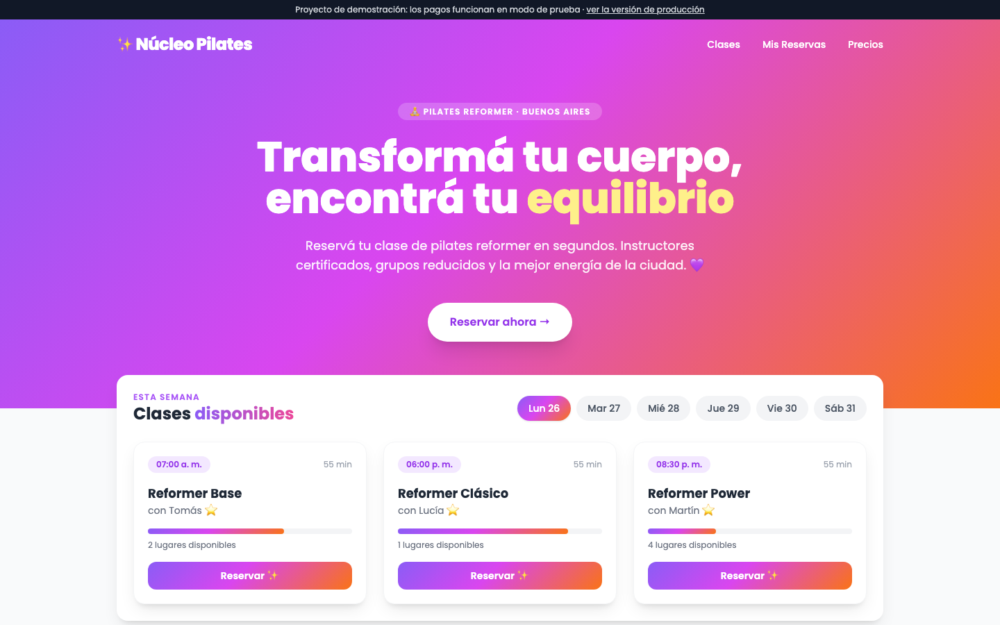
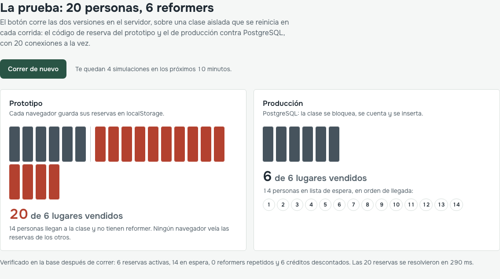
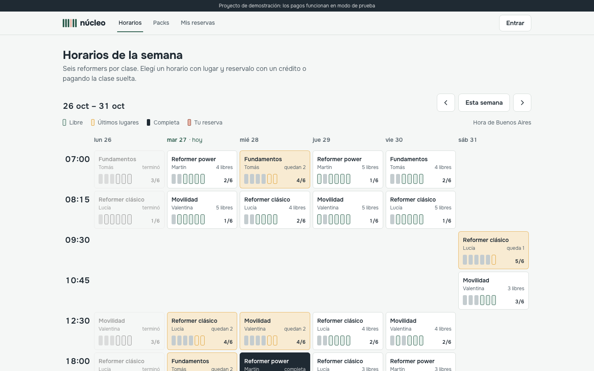
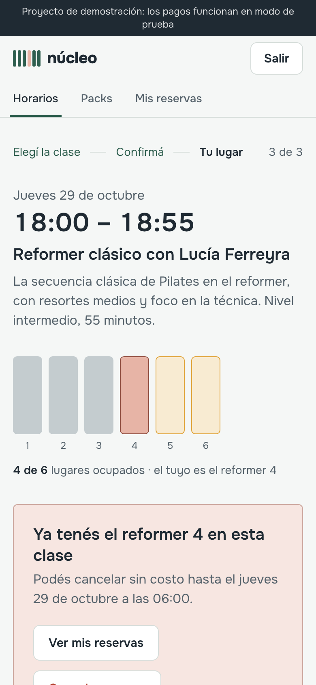
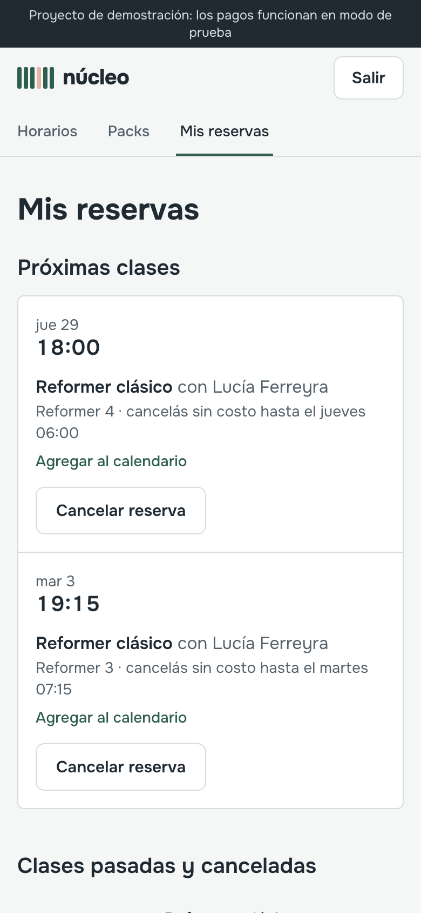
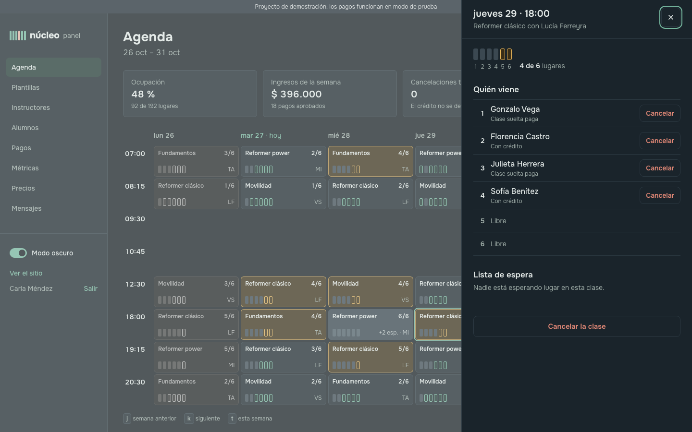
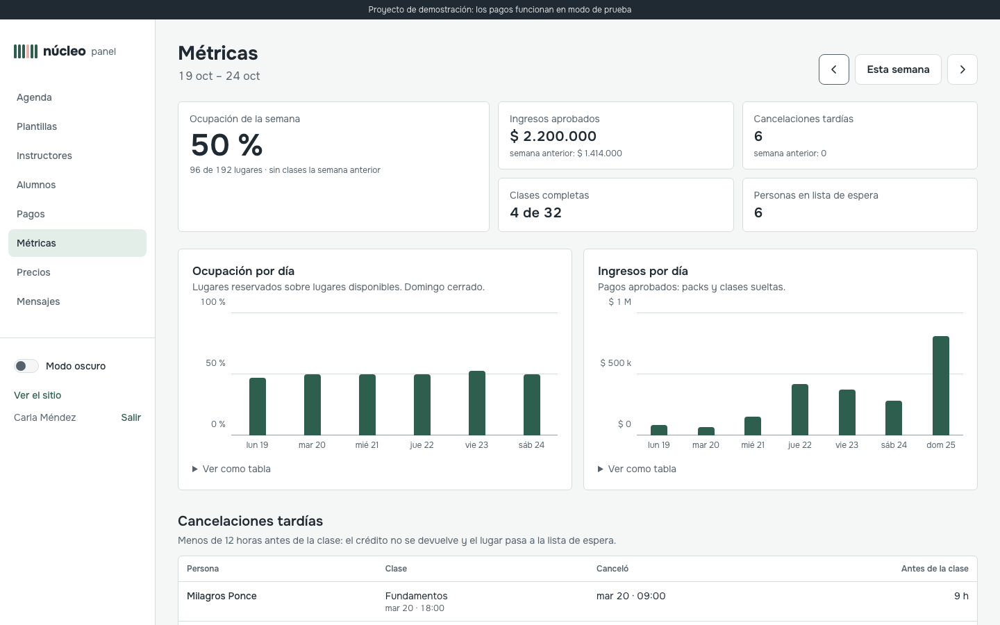

# Caso de estudio: de prototipo a producción

**Núcleo** es un estudio ficticio de pilates reformer en Buenos Aires: 6 reformers, clases de 50
minutos, packs de 4, 8 y 12 clases. El caso arranca donde suelen arrancar estos trabajos: con un
prototipo que el cliente ya mostró, que «anda», y que no está listo para que la gente pague.

La versión en vivo de este caso, con la simulación, está en `/caso` dentro de la app.

## El punto de partida

El prototipo ([`/antes`](../public/antes/index.html)) es un solo archivo HTML. Muestra la semana,
deja reservar y tiene un botón de pagar. En la demo con el cliente funciona: una persona, un
navegador, una reserva por vez.

Los 7 problemas están marcados en el código con `// PROBLEMA:`. Ninguno se ve en una demo; todos
aparecen la primera semana con alumnos reales.

| #   | En el prototipo                                                                        | Qué pasa con gente real                                                              | En producción                                                                                     | Cómo se verifica                                                                     |
| --- | -------------------------------------------------------------------------------------- | ------------------------------------------------------------------------------------ | ------------------------------------------------------------------------------------------------- | ------------------------------------------------------------------------------------ |
| 1   | Las reservas se guardan en el `localStorage` de cada navegador.                        | El estudio no ve quién viene: cada persona tiene su propia agenda.                   | PostgreSQL, con índice único por alumno y clase.                                                  | Tests de integración contra Postgres real.                                           |
| 2   | El cupo se cuenta con las reservas de ese navegador; chequear y guardar son dos pasos. | 20 personas a la vez compran 20 lugares de 6.                                        | Transacción con `SELECT … FOR UPDATE` sobre la clase: bloquear, contar, insertar.                 | `tests/concurrencia.test.ts` y la simulación de `/caso`.                             |
| 3   | El precio sale de un atributo del botón y los cupones están en el código.              | Cualquiera paga lo que quiere desde las herramientas del navegador.                  | El servidor fija el monto al crear la reserva o el pago; el navegador no manda montos.            | Test: el webhook no aprueba un monto distinto.                                       |
| 4   | Pagar es esperar un segundo y marcar «pagada».                                         | Clases confirmadas sin cobrar; una notificación repetida podría acreditar dos veces. | Checkout Pro. Webhook con firma `x-signature`, idempotente, que consulta el estado real a la API. | `tests/webhook.test.ts` (5 casos).                                                   |
| 5   | Sin cuentas: cualquiera cancela cualquier reserva, en cualquier momento.               | Cancelar a último momento devuelve el lugar gratis; se cancelan reservas ajenas.     | Roles y autorización en cada acción del servidor. La regla de 12 horas vive en un solo lugar.     | Tests de reglas y de créditos; e2e de cancelación.                                   |
| 6   | Las horas se calculan con la zona del navegador.                                       | Desde otro país, o con la compu mal configurada, la clase aparece a otra hora.       | UTC en la base, hora de Buenos Aires en pantalla, independiente del navegador y del servidor.     | Test de plantillas: cada clase cae a su hora local.                                  |
| 7   | Sin validación; los nombres se insertan como HTML.                                     | Un «nombre» con HTML ejecuta código en la página del estudio.                        | zod en el servidor y React escapa todo el texto.                                                  | Ningún `dangerouslySetInnerHTML` con datos de usuarios; esquemas zod en cada acción. |

## La prueba: 20 personas, 6 lugares

El problema 2 es el que más plata cuesta y el más difícil de creer en una reunión. Por eso `/caso`
lo muestra en vivo: un botón dispara 20 reservas simultáneas sobre la misma clase, contra las dos
versiones del código.

- **Prototipo**: el código original, portado tal cual a un navegador simulado por persona. Cada
  una ve «6 lugares libres» y reserva. Resultado: **20 lugares vendidos de 6**.
- **Producción**: las 20 reservas llegan al dominio real contra PostgreSQL, cada una en su propia
  conexión. Resultado: **6 reservas confirmadas, 6 reformers distintos, 14 personas en la lista de
  espera** con su puesto, 6 créditos descontados. Las 20 se resuelven en un par de décimas de segundo.

La simulación corre sobre una clase aislada que se recrea en cada corrida, no toca los datos de la
demo, tiene un candado para que dos visitantes no la corran a la vez y un límite de 5 corridas
cada 10 minutos por IP. Después de correr, verifica en la base y muestra lo que encontró.

## Qué se construyó

**Para quien toma clases**

- Horarios de la semana con disponibilidad en tiempo real: cada clase muestra sus 6 reformers como
  carriles, y los últimos lugares se marcan.
- Reserva en 3 pasos (clase, confirmación, lugar asignado) con crédito o pagando la clase suelta.
  Un lugar pendiente de pago queda retenido 10 minutos.
- Packs de 4, 8 y 12 clases válidos por 30 días, con Mercado Pago Checkout Pro.
- Mis reservas: cancelar sin costo hasta 12 horas antes (el crédito vuelve), lista de espera con
  puesto y créditos con su vencimiento.
- Lista de espera automática: cuando se libera un lugar, la primera persona con crédito queda
  reservada; si no tiene, recibe 30 minutos para pagar.
- Recordatorio por email 24 horas antes y vista previa del mensaje de WhatsApp.

| Reserva en el teléfono                    | Mis reservas en el teléfono                         |
| ----------------------------------------- | --------------------------------------------------- |
|  |  |

**Para el estudio**

- Agenda semanal densa con ocupación, lista de espera y panel lateral por clase: asistencia,
  cancelaciones con su consecuencia explicada, cancelar la clase entera.
- Plantillas semanales que generan las clases de las próximas 3 semanas y avisan si se superponen
  (el estudio tiene una sola sala).
- Instructores, alumnos con su ficha (créditos, historial, ajustes manuales auditables), pagos con
  su estado, precios, métricas de la semana y los mensajes que salieron.
- Modo oscuro, recordado por navegador y aplicado antes de pintar.

## Resultados

| Medida                             | Prototipo     | Producción                                            |
| ---------------------------------- | ------------- | ----------------------------------------------------- |
| 20 reservas simultáneas, 6 lugares | 20 vendidos   | 6 confirmados, 14 en espera                           |
| Lighthouse móvil: rendimiento      | 76            | 98 (horarios), 97 (reserva), 97 (caso)                |
| Lighthouse móvil: accesibilidad    | 88            | 100 en las tres páginas                               |
| Lighthouse móvil: SEO              | 90            | 100 en las tres páginas                               |
| LCP / CLS (horarios vs. prototipo) | 3,2 s / 0,214 | 2,4 s / 0                                             |
| Tests automáticos                  | 0             | 48 de Vitest (Postgres real) y 5 flujos de Playwright |

Reportes completos en [`docs/lighthouse`](lighthouse). Los números de `/caso` salen de los mismos
archivos ([`docs/metricas`](metricas)), así que no se pueden desincronizar del repo.

## Decisiones que vale la pena contar

- **El cupo se resuelve en la base, no en la aplicación.** Un bloqueo de fila por clase es simple,
  no necesita colas ni Redis y es fácil de probar: el test lanza 20 reservas en paralelo y exige
  exactamente 6.
- **Mercado Pago como fuente de verdad.** El cuerpo del webhook no se cree: con la firma válida, se
  consulta el pago a la API. Si el pago llega después de que venció la retención, se confirma si
  queda lugar y, si no, se convierte en un crédito: nadie paga y se queda sin nada.
- **Emails con outbox.** Se encolan en la misma transacción que la reserva o la cancelación: no
  hay emails de cosas que no pasaron ni duplicados si una tarea corre dos veces.
- **Modo simulado con reglas claras.** Sin credenciales, todo funciona con un checkout simulado que
  manda el mismo webhook firmado. En producción el simulado no se puede activar, y un test lo
  asegura.
- **Better Auth** para email y contraseña con sesiones en la propia base y el rol como campo que
  el registro no puede tocar.

## Qué seguiría

- Reprogramar arrastrando clases en la agenda, exportar alumnos y pagos a CSV, y agregar la clase
  al calendario con un `.ics`.
- Mandar el recordatorio por WhatsApp Business (hoy es una vista previa).
- Reintentos con backoff para el envío de emails y alertas si una tarea programada falla.
